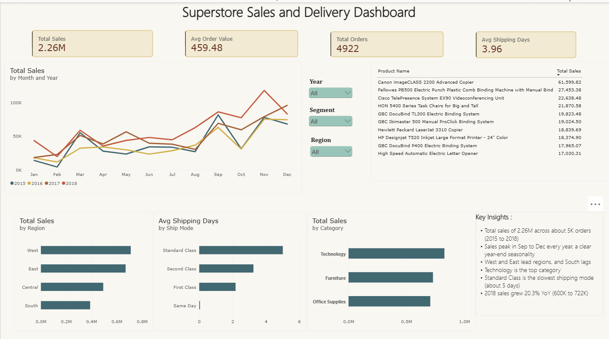

# Superstore Sales & Delivery Dashboard (Power BI)

An interactive Power BI dashboard analyzing sales performance and
delivery speed for a retail dataset (2015-2018).

## Dashboard Preview

## Tools
Power BI Desktop, Power Query, DAX

## Dataset
Superstore sales data (Kaggle): 4,922 orders, 2.26M in total sales.

## What the dashboard shows
- KPIs: Total Sales, Avg Order Value, Total Orders, Avg Shipping Days
- Monthly sales trend by year
- Sales by region, category, and ship mode
- Top 10 products by sales
- Slicers for Year, Segment, and Region

## Key DAX measures
- Total Sales = SUM(Orders[Sales])
- Total Orders = DISTINCTCOUNT(Orders[Order ID])
- Avg Shipping Days = AVERAGE(Orders[Shipping Days])
- Sales YoY % using SAMEPERIODLASTYEAR on a custom date table

## Key Insights
- Sales peak between September and December every year
- 2018 sales grew 20.3% YoY (600K to 722K)
- West and East lead regional sales; South lags
- Technology is the top category
- Standard Class is the slowest shipping mode (~5 days)

## Files
- Superstore_Sales_Dashboard.pbix
- dashboard.png
